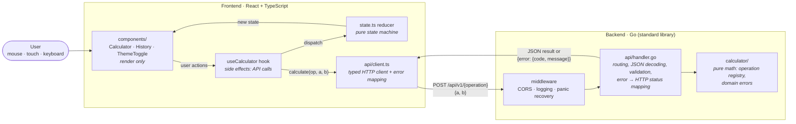
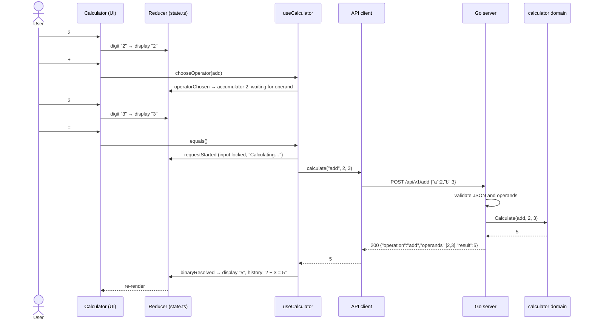
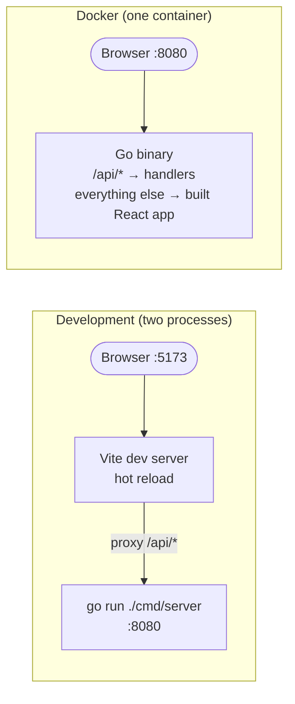

# Full-Stack Calculator

A calculator with a **React + TypeScript** frontend and a **Go** REST microservice.
The frontend never does arithmetic itself: every operation is sent to the backend,
which validates the input and returns the result as JSON.

| Layer    | Stack                                                        |
| -------- | ------------------------------------------------------------ |
| Frontend | React 19, TypeScript, Vite, Vitest + Testing Library         |
| Backend  | Go 1.24, standard library only (`net/http`, `log/slog`)      |
| Delivery | Multi-stage Dockerfile → one distroless image serving both   |

**Operations:** addition, subtraction, multiplication, division, and the optional
exponentiation, square root and percentage.

**Highlights:** classic calculator UX with operation chaining and full keyboard support ·
calculation history (with *clear history*) · mobile layout with swipe between calculator and
history · fluid layout for every screen size · light/dark theme toggle · strict API validation
with stable error codes · 64 frontend + 70+ backend test cases · single-container Docker image.

---

## Architecture

### Overview



Each layer has one job and depends only on the layer below it, which is what makes every
layer testable in isolation:

| Layer | Responsibility | Knows about | Tested with |
| --- | --- | --- | --- |
| `calculator` (Go) | The math and its rules (division by zero, finite results) | nothing else | table-driven unit tests |
| `api` (Go) | HTTP: routes, strict JSON parsing, validation, status codes | `calculator` | `httptest` |
| `api/client.ts` | Talk to the API, turn error codes into messages | `fetch` (injected) | fake `fetch` |
| `state.ts` | Every UI state transition, as a pure function | nothing else | plain unit tests |
| `useCalculator` | Orchestrate: call the API, dispatch the outcome | client + reducer | via component tests |
| components | Render state, forward clicks and keys | the hook | Testing Library + fake client |

### What happens when you type `2 + 3 =`



On an error (e.g. `8 ÷ 0`) the backend answers `422 {"error":{"code":"DIVISION_BY_ZERO",...}}`,
the client throws a `CalculatorApiError`, the hook dispatches `failed` and the UI shows
*"Cannot divide by zero"*; the next key press clears it.

### Deployment



Both setups serve the frontend and the API from the **same origin**, so the browser never
needs CORS. The Dockerfile builds the React app with Node, compiles a static Go binary, and
copies both into a ~10 MB distroless image that runs as a non-root user.

---

## Project structure

```
.
├── backend/
│   ├── cmd/server/main.go       # config from env, middleware wiring, graceful shutdown
│   └── internal/
│       ├── calculator/          # pure domain: operation registry, domain errors (+ tests)
│       └── api/
│           ├── handler.go       # routes, JSON decoding, validation, error mapping (+ tests)
│           └── middleware.go    # CORS, logging, recovery, SPA static files (+ tests)
├── frontend/
│   ├── index.html               # applies saved theme before first paint
│   └── src/
│       ├── api/client.ts        # typed API client + friendly error messages (+ tests)
│       ├── calculator/
│       │   ├── state.ts         # pure reducer: all UI state transitions (+ tests)
│       │   └── useCalculator.ts # hook: API calls → reducer actions
│       ├── components/
│       │   ├── Calculator.tsx   # display, keypad, keyboard shortcuts, mobile tabs (+ tests)
│       │   └── History.tsx      # last 10 results + clear button
│       ├── theme/               # useTheme hook + ThemeToggle (+ tests)
│       └── styles.css           # design tokens, light/dark themes, responsive layout
├── docs/coverage/               # generated coverage reports (HTML + summaries)
├── Dockerfile                   # multi-stage: Node build → Go build → distroless runtime
├── Makefile                     # shortcuts (Linux/macOS)
└── PROMPTS.md                   # prompts used during development
```

---

## Setup

### Prerequisites

- **Go** 1.24+ — <https://go.dev/dl/>
- **Node.js** 20.19+ (22 LTS recommended) and npm
- *(optional)* **Docker** to run the full stack as one container

### Run locally (two terminals)

**Terminal 1 — backend** (listens on `http://localhost:8080`):

```bash
cd backend
go run ./cmd/server
```

**Terminal 2 — frontend** (opens on `http://localhost:5173`):

```bash
cd frontend
npm install
npm run dev
```

Open <http://localhost:5173>. The Vite dev server proxies `/api/*` to the backend,
so no CORS setup is needed during development.

### Run with Docker (frontend + backend together)

```bash
docker build -t sezzle-calculator .
docker run --rm -p 8080:8080 sezzle-calculator
```

Open <http://localhost:8080>. The Go binary serves the built React app and the API
from the same origin.

### Configuration

| Variable          | Default                 | Description                                         |
| ----------------- | ----------------------- | --------------------------------------------------- |
| `PORT`            | `8080`                  | Backend port                                        |
| `ALLOWED_ORIGINS` | `http://localhost:5173` | Comma-separated CORS origins (`*` allows any)       |
| `STATIC_DIR`      | *(empty)*               | If set, the backend also serves the built frontend  |
| `VITE_API_URL`    | *(empty = same origin)* | Frontend build-time API base URL                    |
| `BACKEND_URL`     | `http://localhost:8080` | Where the Vite dev proxy forwards `/api`            |

---

## Tests and coverage

```bash
# Backend
cd backend
go test ./... -cover
go test ./... -coverprofile=coverage.out && go tool cover -html=coverage.out

# Frontend
cd frontend
npm test              # run once
npm run coverage      # with coverage (HTML in frontend/coverage/)
npm run typecheck     # tsc
```

Or simply `make test` / `make coverage`.

**Current coverage** (reports committed in [`docs/coverage/`](docs/coverage/)):

| Package / file                        | Statements |
| ------------------------------------- | ---------- |
| `backend/internal/calculator`         | 100%       |
| `backend/internal/api`                | 97.5%      |
| `frontend` (all files)                | 97.5% (98.9% lines) |

`cmd/server/main.go` is intentionally thin (env parsing + `ListenAndServe`) and is not
unit tested; all behaviour lives in the tested `internal` packages.

What is tested:

- **Domain:** every operation, negative/decimal operands, division by zero, `√` of negatives,
  overflow (`10^400`, `MaxFloat64 × 2`), NaN results (`(-8)^0.5`), NaN/Inf inputs, wrong arity,
  `-0` normalisation.
- **HTTP:** success responses and their exact JSON shape, every error code, missing / `null` /
  string / out-of-range operands, unknown fields, malformed or empty body, trailing JSON,
  oversized payloads, wrong `Content-Type`, wrong method, CORS, panic recovery, static serving.
- **Frontend (64 tests):** the reducer (number entry, digit limit, sign, backspace, chaining,
  errors, history, clear history), the API client (success, error codes, non-JSON errors, network failures,
  malformed responses) and the UI end-to-end with a fake backend (mouse, keyboard and the
  mobile panel tabs / swipe) and the theme hook (system default, live OS changes, persistence,
  blocked storage).

---

## API

Base URL: `http://localhost:8080`

| Method | Path                     | Description                          |
| ------ | ------------------------ | ------------------------------------ |
| POST   | `/api/v1/{operation}`    | Run an operation                     |
| GET    | `/api/v1/operations`     | List supported operations and arity  |
| GET    | `/healthz`               | Liveness check                       |

### Operations

| `{operation}` | Body             | Result              |
| ------------- | ---------------- | ------------------- |
| `add`         | `{"a": 2, "b": 3}` | `a + b`           |
| `subtract`    | `{"a": 2, "b": 3}` | `a − b`           |
| `multiply`    | `{"a": 2, "b": 3}` | `a × b`           |
| `divide`      | `{"a": 2, "b": 3}` | `a ÷ b`           |
| `power`       | `{"a": 2, "b": 3}` | `a ^ b`           |
| `percentage`  | `{"a": 15, "b": 200}` | `a % of b` = `a × b / 100` |
| `sqrt`        | `{"a": 16}`      | `√a` (`b` is rejected) |

### Examples

```bash
curl -X POST http://localhost:8080/api/v1/add \
  -H "Content-Type: application/json" \
  -d '{"a": 2, "b": 3}'
# 200 {"operation":"add","operands":[2,3],"result":5}

curl -X POST http://localhost:8080/api/v1/sqrt \
  -H "Content-Type: application/json" \
  -d '{"a": 81}'
# 200 {"operation":"sqrt","operands":[81],"result":9}

curl -X POST http://localhost:8080/api/v1/divide \
  -H "Content-Type: application/json" \
  -d '{"a": 1, "b": 0}'
# 422 {"error":{"code":"DIVISION_BY_ZERO","message":"division by zero"}}

curl -X POST http://localhost:8080/api/v1/add \
  -H "Content-Type: application/json" \
  -d '{"a": "2", "b": 3}'
# 400 {"error":{"code":"INVALID_OPERAND","message":"field \"a\" must be a number"}}

curl http://localhost:8080/api/v1/operations
# 200 {"operations":[{"name":"add","arity":2,"description":"a + b"}, ...]}
```

> **Windows PowerShell:** `Invoke-RestMethod -Method Post -Uri http://localhost:8080/api/v1/add -ContentType 'application/json' -Body '{"a":2,"b":3}'`

### Errors

Every error has the same shape — a stable `code` for programs and a `message` for humans:

```json
{ "error": { "code": "DIVISION_BY_ZERO", "message": "division by zero" } }
```

| HTTP | `code`                  | When                                                   |
| ---- | ----------------------- | ------------------------------------------------------ |
| 400  | `INVALID_JSON`          | Malformed, empty, non-object or trailing JSON; unknown fields |
| 400  | `INVALID_OPERAND`       | Missing, `null`, non-numeric or out-of-range operand; extra `b` for `sqrt` |
| 404  | `UNKNOWN_OPERATION`     | `{operation}` is not supported                          |
| 405  | —                       | Wrong HTTP method                                      |
| 413  | `PAYLOAD_TOO_LARGE`     | Body larger than 1 KiB                                  |
| 415  | `UNSUPPORTED_MEDIA_TYPE`| `Content-Type` is not `application/json`                |
| 422  | `DIVISION_BY_ZERO`      | `b` is 0 in `divide`                                    |
| 422  | `NEGATIVE_SQUARE_ROOT`  | `a` < 0 in `sqrt`                                       |
| 422  | `RESULT_OUT_OF_RANGE`   | Result would be ±Inf or NaN (e.g. `10^400`, `(-8)^0.5`) |
| 500  | `INTERNAL_ERROR`        | Unexpected failure (also returned on recovered panics)  |

---

## Design decisions

**Backend**

- **Domain separated from transport.** `internal/calculator` is pure Go with no HTTP or JSON;
  operations live in a small registry (`name → arity + function`). Adding an operation is one
  map entry, and the HTTP layer, the `/operations` endpoint and validation pick it up
  automatically.
- **One endpoint per operation** (`POST /api/v1/add`) instead of a generic `/calculate`
  with an `op` field: URLs are self-describing, an unknown operation is naturally a `404`, and
  each operation can evolve independently. The API is versioned (`/v1`) from day one.
- **Named operands `a` / `b`** rather than an array: the order matters for subtraction,
  division, power and percentage, and named fields make that explicit.
- **Strict input validation.** Pointer fields distinguish a missing value from `0`, unknown
  fields and trailing data are rejected, bodies are capped at 1 KiB and the `Content-Type`
  is checked. Errors say *what* is wrong, not just that something is.
- **Results are always finite.** JSON cannot encode NaN/±Inf, so the domain refuses to return
  them and reports `RESULT_OUT_OF_RANGE`. `-0` is normalised to `0`.
- **Status codes:** `400` for a malformed request, `422` for a well-formed request that is
  mathematically invalid (division by zero), `404` for an unknown operation.
- **Standard library only.** Go 1.22+ `ServeMux` supports method + path patterns, so no router
  dependency is needed. Small middlewares handle CORS, structured logging (`slog`), panic
  recovery and serving the SPA. The server has timeouts and graceful shutdown.
- **`float64`** is used for numbers: it matches JavaScript's number type end to end. Classic
  floating point artefacts (`0.1 + 0.2`) are hidden by formatting on the frontend (12
  significant digits) rather than by changing the math. Arbitrary precision decimals would be
  the next step for a financial context.

**Frontend**

- **Classic calculator UX** (type a number, pick an operator, type another, `=`), with
  left-to-right chaining (`2 + 3 ×` computes `5` first), a visible pending expression, the
  active operator highlighted and a history of the last 10 results. Full keyboard support.
- **State as a pure reducer** (`calculator/state.ts`): every UI transition is a plain function
  that is unit tested without React. Side effects (API calls) live in the `useCalculator` hook,
  and components only render — a clear separation of state, effects and view.
- **Typed API client** with dependency injection (`createClient(baseUrl, fetch)`): tests pass a
  fake `fetch` or a fake client, so UI tests are fast and deterministic. Backend error codes
  are translated into friendly messages in one place.
- **Input validation in the UI** prevents what can be prevented locally (one decimal point,
  no leading zeros, 15-digit limit, input ignored while a request is in flight) and shows the
  backend's validation errors when they happen; the next key press clears the error.
- **Mobile-first swipe navigation:** on small screens the calculator and the history are two
  full-width panels; swipe sideways to switch, or tap the *Calculator / History* tabs (the
  history tab shows a count badge). It uses native CSS `scroll-snap` instead of a gesture
  library, so it is lightweight and feels native on iOS and Android. On desktop both panels
  stay side by side. A *Clear history* button sits below the history (pinned to the bottom of
  the panel on phones, within thumb reach).
- **Fluid layout for every screen size:** on phones the calculator fills the whole screen and
  the keypad stretches to the available height (safe-area aware, `100dvh`); short screens and
  phones in landscape switch to a compact layout so the keypad always fits without scrolling;
  large monitors get a roomier layout.
- **Light / dark theme toggle:** follows the operating system by default (and live changes to
  it); the sun/moon button overrides it and the choice is remembered in `localStorage`. A tiny
  inline script applies the saved theme before first paint to avoid a flash of the wrong theme.
- **Accessible:** large touch targets, results announced via `aria-live`, errors via
  `role="alert"`, visible focus, `prefers-reduced-motion` respected.

**Assumptions**

- "Percentage" means *a percent of b* (`15 % of 200 = 30`), the most common meaning on
  calculators; the button is labelled **% of** to remove ambiguity.
- Square root is unary and applies to the number on the display; its result can be used as the
  right-hand operand (`9 + √16 = 13`).
- No authentication, persistence or rate limiting — out of scope for this exercise.
